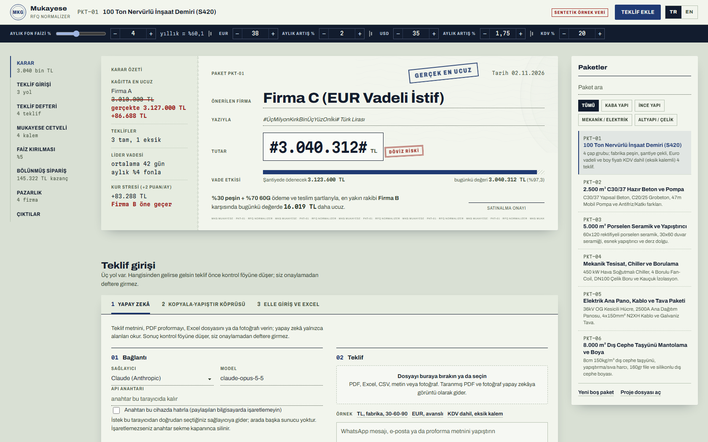

# Mukayese · RFQ Normalizer

Tedarikçi tekliflerini aynı tabana indirip **gerçekte hangisinin ucuz olduğunu** gösteren açık kaynak satınalma motoru. Tarayıcıda çalışır; kurulum, sunucu ya da veritabanı gerektirmez.

**Canlı demo:** https://onurguntepe.github.io/rfq-normalizer/



> *English summary below.*

Şantiyeye beş teklif gelir. Biri "fabrika teslim, TL peşin" yazar, biri "şantiye teslim, 30-60-90 gün çek", biri "Euro, %30 avans, 60 gün vade, KDV dahil". Kağıt üzerinde en ucuz görünen teklif, nakliye, vinç, fire, KDV ve paranın zaman değeri eklenince çoğu zaman en ucuz değildir. Bu uygulama her teklifi şu sırayla aynı tabana getirir:

1. **Kağıt üzeri**: tedarikçinin yazdığı rakam, spot kurla TL.
2. **Şantiye istif**: KDV ayrıştırılır, birimler eşitlenir (ton, kg, metre, 12 m boy), fire eklenir, nakliye ve vinç eklenir.
3. **Bugünkü peşin karşılık**: her ödeme vade günündeki beklenen kurla TL'ye çevrilir ve şirketin aylık fon faiziyle bugüne indirgenir.

Sonuç, güvenlik baskılı bir belge görünümündeki karar kartında verilir: önerilen firma, bugünkü maliyet rakamla ve yazıyla, yanında karar özeti ve kağıtta en ucuz görünen teklifin kırmızı kalemle düzeltilmiş hali.

## Özellikler

- **Üç veri giriş yolu ve Excel şablonu**
  - **Yapay zekâ (kendi anahtarınızla):** Claude, OpenAI uyumlu herhangi bir uç nokta (kendi proxy'niz dahil) veya Gemini. Metin, PDF, Excel, CSV ya da fotoğraf. İstek tarayıcıdan doğrudan sağlayıcıya gider; arada bizim sunucumuz yoktur.
  - **Kopyala-yapıştır köprüsü:** API anahtarı gerekmez. Uygulama komutu hazırlar, siz kendi ChatGPT, Claude veya Gemini sohbetinize yapıştırırsınız, dönen cevabı geri yapıştırırsınız. Cevabın etrafındaki açıklama metni ayıklanır.
  - **Elle giriş ve Excel şablonu:** İnternet ya da yapay zekâ olmadan. Şablon paketin kalemlerini sırasıyla içerir; tedarikçiye gönderilip geri yüklenebilir.
  - **Yapay zekâsız tahmini okuma:** Kısa WhatsApp mesajı gibi düzgün yazılmış metinlerde fiyat, vade, nakliye ve KDV durumunu çevrimdışı yakalar. Tahmin olarak etiketlenir.
- **Kontrol föyü:** Hangi yoldan gelirse gelsin her teklif önce kontrol föyüne düşer. Ödeme oranları %100 etmiyorsa, birim dönüşümü bilinmiyorsa ya da firma adı boşsa kayıt deftere işlenemez. Eksik fiyat başka firmadan **kopyalanmaz**; eksik kalemli teklif genel sıralamaya girmez.
- **Birim eşitleme:** Donatı çapı tanımlanan kalemde ton, kg, metre ve 12 m boy arasında teorik ağırlıkla (π/4·d²·7850 kg/m³) otomatik dönüşüm. Diğer birimler için dönüşüm katsayısı girilir.
- **Lojistik:** Nakliye, vinç ve fire; fabrika teslim teklifler için tonaj ve mesafeye göre kaba lojistik hesaplayıcı (bütün oranlar değiştirilebilir varsayımdır).
- **Faiz kırılma noktası:** Her tam teklifin bugünkü maliyeti aylık faize göre çizilir; liderin hangi faizde değiştiği ikiye bölme yöntemiyle hesaplanır ve yazılır.
- **Kur stresi:** Lider dövizli ise kur artışı ayda +2 puan sapınca maliyetin ne olacağı ve sıralamanın değişip değişmediği.
- **Bölünmüş sipariş:** Kalemleri firmalara dağıtmanın en ucuz yolu, siparişe giren **her firmanın nakliye ve vinç bedeli tam sayılarak**, bütün firma kombinasyonları denenip kesin olarak bulunur. Nakliyeyi kalemlere paylaştıran kısa yolun ne kadar yanılttığı da gösterilir.
- **Pazarlık reçetesi:** Lidere ve her rakibe ne isteneceği hesaplanır: lideri geçmek için gereken indirim yüzdesi, hedef kağıt toplamı veya eşdeğer ek vade günü. Taslak mektup hazırdır; yapay zekâ bağlıysa yalnızca cümleyi düzeltir, rakama dokunmaz.
- **Çıktılar:** İmzaya hazır onay formu (A4 / PDF), sipariş mektubu, Excel ve CSV mukayese tablosu, bütçe sistemlerine aktarım için JSON karar verisi, boş teklif şablonu, proje kaydetme ve açma.
- Türkçe ve İngilizce arayüz. Telefonda da çalışır.

## Çalıştırma

Hiçbir kurulum gerekmez.

- `index.html` dosyasını tarayıcıda açın (çift tıklama yeterli), **ya da**
- klasörde yerel bir sunucu başlatın:

```bash
python -m http.server 8000
```

ve `http://localhost:8000` adresini açın, **ya da**
- repo'yu GitHub'a koyup **Settings → Pages → Deploy from branch → main / root** ile yayınlayın.

PDF ve Excel okuma kütüphaneleri (pdf.js, SheetJS) yalnızca bir dosya bırakıldığında cdnjs üzerinden yüklenir. Uygulamanın geri kalanı çevrimdışı çalışır. Yazı tipleri Google Fonts'tan gelir; bağlantı yoksa sistem yazı tipi kullanılır.

## Hesap

Her şey `js/engine.js` içindeki deterministik fonksiyonlarla hesaplanır. Yapay zekâ hiçbir toplamı hesaplamaz.

Bir ödemenin bugünkü değer çarpanı:

```
çarpan = Σ  pay_i × (1 + g)^(gün_i/30) / (1 + r)^(gün_i/30)
```

- `r`: aylık TL fon faizi (alternatif getiri)
- `g`: teklif dövizinin aylık beklenen artışı (TL teklifte 0)
- `pay_i`: ödeme diliminin oranı, toplam 1

Bugünkü peşin karşılık = (KDV hariç net malzeme + fire) × çarpan × spot kur + nakliye + vinç.

Örnek: 90 gün sonraki 1.000.000 TL'lik çek, aylık %4 faizde bugün 888.996 TL eder.

**Varsayımlar** (arayüzde de yazar): ay 30 gündür; nakliye ve vinç teslimde peşin ödenir; mukayese KDV hariç yapılır, yani KDV indirilebilir kabul edilir; kur artışı aylık bileşik işler; fire malzeme bedeline eklenir ve aynı vadede ödenir; bölünmüş siparişte firma birim fiyatını korur ve nakliye bedelini tam alır.

## Yapay zekâ bağlantısı hakkında

- Anahtar, siz "bu cihazda hatırla" demedikçe yalnız sekme açıkken bellekte tutulur. Paylaşılan bilgisayarda hatırlatmayın.
- Claude için tarayıcıdan doğrudan erişim başlığı (`anthropic-dangerous-direct-browser-access`) kullanılır ve cevap JSON şemasıyla sınırlanır. Varsayılan model `claude-opus-5-5`; masraf için listeden Sonnet ya da Haiku seçilebilir.
- Bazı sağlayıcılar tarayıcıdan doğrudan çağrıya izin vermeyebilir (CORS). Bu durumda "OpenAI uyumlu uç nokta" seçeneğiyle kendi proxy'nizi (örneğin bir Cloudflare Worker) gösterin; anahtar proxy'de kalır, alan boş bırakılabilir.
- Gemini varsayılan model adı zamanla değişebilir; model alanına güncel adı yazın.

## Dosya yapısı

```
index.html          sayfa iskeleti
css/app.css         görsel dil (DESIGN.md)
js/engine.js        hesap motoru: birim, KDV, lojistik, NPV, bölünmüş sipariş, kırılma noktası
js/parser.js        teklif normalleştirme, JSON ayıklama, yapay zekâsız okuma, komut
js/model.js         proje modeli, içe/dışa aktarım, CSV
js/ai.js            Claude / OpenAI uyumlu / Gemini çağrıları
js/files.js         PDF, Excel, CSV okuma; şablon
js/charts.js        SVG ödeme şeridi ve faiz grafiği
js/words.js         tutarı yazıyla yazma
js/i18n.js          Türkçe ve İngilizce metinler
js/scenarios.js     10 sentetik örnek paket
js/app.js           arayüz
tests/              motor, ayrıştırıcı ve karar bekçisi testleri
```

## Test

Node.js 22 veya üstü yeterlidir; bağımlılık yoktur.

```bash
node --test "tests/*.test.js"
```

## Örnek veri

Örnek paketlerdeki firma adları ("Firma A", "Firma B"...) ve fiyatlar **sentetiktir**; gerçek bir firmayı veya piyasa fiyatını temsil etmez. Kendi tekliflerinizle çalışırken veriler tarayıcınızın yerel deposunda kalır.

## Yol haritası

- Şirket içi ortak satınalma havuzu için isteğe bağlı Cloudflare Workers + D1 senkronu
- İç verim oranı (IRR) görünümü
- Kalem bazında farklı teslim tarihleri

## Lisans

MIT. Ticari dahil her türlü kullanım, değiştirme ve dağıtım serbesttir; yalnızca lisans metni korunmalıdır. Ayrıntı için `LICENSE`.

---

## English

**RFQ Normalizer** puts supplier quotes on one basis (landed on site, VAT excluded, discounted to today's cash value at your own monthly funding rate and expected FX drift) and prints the verdict for the supplier that is really cheapest.

- Three ways in: direct AI with **your own key** (Claude, any OpenAI-compatible endpoint or proxy, Gemini), a **zero-cost copy-paste bridge** to your own chat assistant, and **manual entry / Excel template**. An offline reader handles simple messages without AI and is labelled as a guess.
- Every quote passes a **review sheet** before it is booked. Payment shares must total 100%, unknown unit conversions block saving, and missing prices are never borrowed from another supplier.
- Unit conversion by theoretical bar weight, VAT normalisation, freight, crane and waste, NPV per payment tranche, an **exact split-order search that charges full freight to every supplier used**, interest-rate break-even, FX stress test and a computed negotiation plan.
- Outputs: approval form, order letter, XLSX/CSV, decision JSON, blank quote template, project save/open.
- Plain HTML/CSS/JS, no build step. Open `index.html`, or serve the folder, or publish it with GitHub Pages. Run the tests with `node --test "tests/*.test.js"`.

Live demo: https://onurguntepe.github.io/rfq-normalizer/. Demo data is synthetic. MIT licensed: use it for anything, including commercial work.
